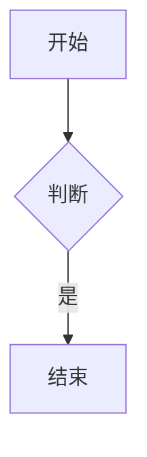

# 一级标题

## 二级标题

### 三级标题

#### 四级标题

##### 五级标题

###### 六级标题

段落第一行（行尾两个空格）  
段落第二行。无空格测试：中文English混排123数字。

**粗体** *斜体* ***粗斜体*** ~~删除线~~ `行内代码` [普通链接](https://example.com) <https://auto.example.com> [[目标笔记|双链别名]] [[仅目标]]

- 无序一
- 无序二
  - 嵌套二一
  - 嵌套二二
    - 三层

3. 有序从三开始
4. 第四项

- [ ] 未完成任务
- [x] 已完成任务

> 一级引用
>
> > 嵌套引用
>
> - 引用里的列表

| 左对齐 | 居中 | 右对齐 |
| :----- | :--: | -----: |
| A      |  `B` |      C |
| 长内容 |  中  |     右 |

```js
const answer = 42; // 高亮
```

```
无语言代码块
第二行
```

行内公式 $E = mc^2$ 结束。

$$
\int_0^1 x^2 dx = \frac{1}{3}
$$


---

脚注示例[^1]，再一个[^note]。

[^1]: 第一条脚注内容。
[^note]: 第二条脚注内容。

<div class="html-block" style="color:red">内联 HTML 段落</div>

内联片段：按 <kbd>Ctrl</kbd> + <kbd>S</kbd> 保存。

<div class="html-danger" onclick="window.__xss2 = 1">带事件属性的块</div>

<script>window.__xss = 1</script>

<!-- pagebreak -->



```tldraw
{"v":1,"strokes":[],"shapes":[]}
```
